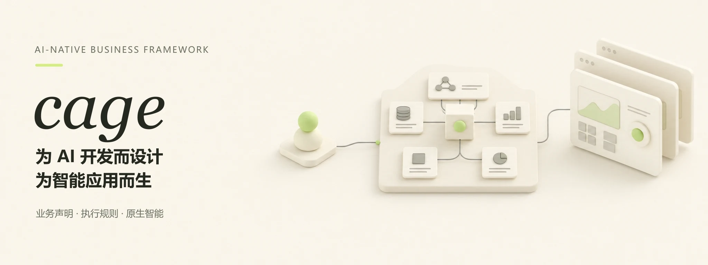
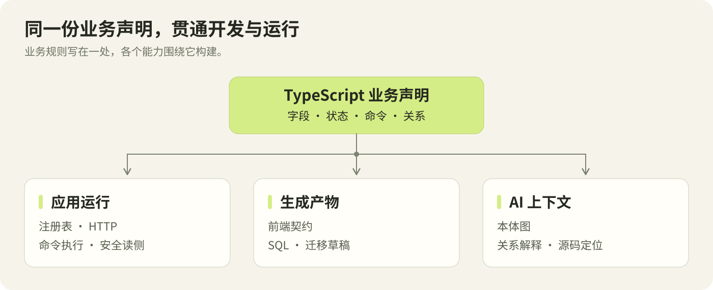
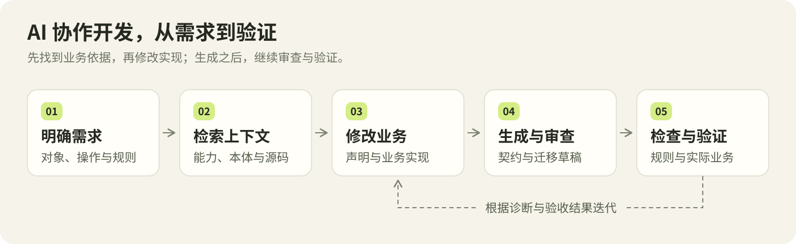
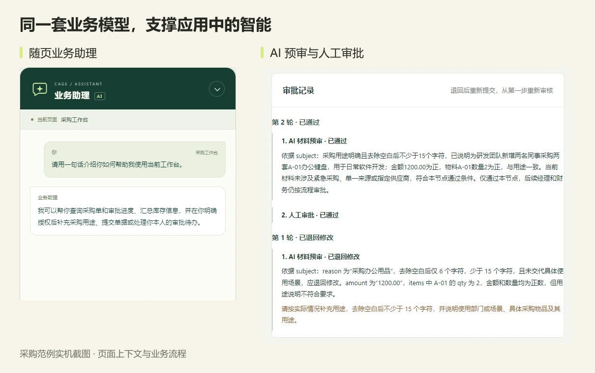

# Cage

**为 AI 开发而设计，为智能应用而生。**

Cage 是一个主要面向 **AI 编程智能体**使用的 TypeScript 业务框架。它把业务对象、操作、规则与流程组织成结构化声明，为 AI 提供可检索的上下文、明确的开发入口和可验证的反馈，并让应用中的智能助理与智能审批沿用同一套业务模型。



[开始使用](#开始使用) · [文档目录](docs/README.md) · [框架开发 Skill](docs/development/skills/cage-development/SKILL.md) · [框架开发指南](docs/development/README.md) · [架构与执行模型](docs/development/getting-started/architecture.md) · [原生智能能力](docs/development/guides/intelligence.md) · [采购范例](examples/purchase-admin)

## 为什么要为 AI 设计一个业务框架

AI 开发业务系统，需要知道现有能力在哪里、业务之间如何关联、哪些规则必须遵守，以及如何确认修改有效。业务越复杂，这些信息越容易分散在路由、数据库、页面和后台任务中。

Cage 将这些信息组织成明确的开发入口。人提出业务目标、确认关键规则并验收结果，AI 围绕声明、上下文与工具完成实现，框架负责执行通用机制。

| 设计目标 | Cage 提供什么 |
| --- | --- |
| **能力有据可查** | 检索当前版本的公开签名、声明位置与使用指南；项目自带 `AGENTS.md`、标准范例和错误码册 |
| **业务关系可以追溯** | 从声明抽取本体图，按需求查对象、操作、关联原因与源码位置 |
| **业务规则有统一执行入口** | 通过命令落实权限、状态、范围、版本、事务等规则，通过安全读侧查询 |
| **修改有明确反馈** | 生成契约和迁移草稿，检查声明与依赖，诊断注册、构建和运行状态 |

> 让 AI 有依据地理解业务，有边界地修改业务，有证据地验证结果。

## 一份业务声明，贯通开发与运行

Cage 的中心是一份可执行的业务规格。用 TypeScript 声明业务对象的字段、关系、状态和约束，再通过命令、事件、反应、审批与连接器表达业务行为。

同一份声明构建注册表、能力目录与 HTTP 路由，生成前端契约、安全 SQL 和迁移草稿，同时为本体图谱和 AI 上下文提供结构依据。



业务对象在 Cage 中称为**聚合**：它把需要共同遵守规则的数据、状态和操作放在一起。例如采购单既包含金额、明细和部门，也定义何时能提交、批准或取消。

下面的取消命令节选自[采购领域声明](examples/purchase-admin/packages/domain/src/modules/purchase/purchase-order.ts)。`PurchaseOrder` 和 `OrderCancelled` 已在该模块声明，`command`、`emit` 来自 `@yss123/cage-kernel`。

```ts
/**
 * 取消草稿、待审批或已批准的采购单；其他状态由内核拒绝。
 * 事件保留取消前状态，供审批关闭和库存释放的订阅者判断后续动作。
 * handler 返回当前业务内容，目标状态、权限、版本及事务提交由内核处理。
 * 已批准单据的库存释放由异步反应执行，不保证在本次取消返回前完成。
 */
export const cancel = command(PurchaseOrder, {
  from: ['draft', 'pending_approval', 'approved'],
  to: 'cancelled',
  emits: [emit(OrderCancelled, (order, _input, previous) => ({
    orderId: order.id,
    previousStatus: previous.status,
  }))],
  handler: (order) => order,
});
```

从这段声明可以读出允许的状态、目标状态和业务事件；关联的审批、反应与释放命令则定义后续行为。AI 可以沿关系定位这些实现，开发者也能在图谱中查看它们。新增操作仍需从 domain 入口导出，并由管理员显式授权。

前端通过生成契约和客户端调用业务能力。页面、交互和具体业务计算由应用实现，数据库结构变化以审查后的迁移落地。完整模式见[原语与最小业务](docs/development/reference/primitives.md)和[对象关系](docs/development/guides/relations.md)。

## AI 如何使用 Cage 开发业务

先加载[框架开发 Skill](docs/development/skills/cage-development/SKILL.md)，理解运行方式和能力选择；初次接触可沿[第一条完整业务链](docs/development/getting-started/first-feature.md)学习声明、生成、授权和页面接入。Skill 与教材随项目分发，多种 agent 共用同一正文，通过本地文件搜索、能力目录和本体查询定位资料，无需额外知识服务或模型。

以“调整采购单取消规则，并核对取消后的库存释放”为例，AI 先定位已有声明和关联流程，再修改实现、生成产物并验证结果。



在应用根目录，开发工具可以直接使用这些入口：

```powershell
# 找到当前应用的业务入口、关系与源码。
pnpm exec cage context "采购单取消与库存释放"

# 查询当前安装版本提供的公开 API。
pnpm exec cage capabilities "reaction" --format json

# 修改前保存本体基线，修改后查看结构影响。
pnpm exec cage snapshot save before-cancel-change
# 在此完成声明、业务实现及相关页面的修改。
pnpm exec cage impact --snapshot before-cancel-change --format json

# 检查声明，生成契约与迁移草稿，再诊断注册和产物状态。
pnpm exec cage check
pnpm gen
pnpm exec cage doctor
```

`context` 帮助找到业务，`capabilities` 核对框架能力，`impact` 比较本体变化，`doctor` 提供诊断证据。结构检查之后，还需要审查生成差异、运行相关测试并验收实际业务；诊断中的 `unknown` 表示尚无验证证据。

每个脚手架项目都携带本地学习资料。可以把这样的任务交给 AI 编程工具：

> 先读根目录 AGENTS.md 和 docs/development/README.md，检索相关能力与业务上下文。为当前应用实现设备借用：申请、审批、领用和归还。先核对业务规则，再修改领域声明与页面，生成并审查契约和迁移，完成权限、状态与业务流程验证，分别报告通过、跳过和未执行的项目。

日常业务开发使用已安装的框架包和项目内资料即可。进一步了解[本体与 AI 上下文](docs/development/tools/ontology-context.md)、[能力发现与诊断](docs/development/tools/diagnostics.md)和[业务任务配方](docs/development/guides/recipes.md)。

## 让每个应用拥有原生智能的基础

开发阶段，AI 使用 Cage 理解和构建业务；运行阶段，应用中的 AI 基于同一套业务定义发现能力、获取上下文并参与执行。

**业务模型提供上下文，业务命令提供行动入口，执行规则约束每一次操作。**

| 智能能力 | 如何进入业务 |
| --- | --- |
| **业务助理** | 从注册表发现当前用户获授权的对象、查询和命令，读取业务数据，并按确认策略执行操作 |
| **随页上下文** | 页面通过 SDK 提供当前对象、选中项、筛选和未保存草稿，服务端重新核验相关访问权限 |
| **AI 审批** | 在现有审批流程中配置 AI 节点，支持通过、退回修改或转人工，最终结论由领域命令落实 |
| **持续交互** | 框架提供持久会话、工具执行、流式接口、偏好记忆和上下文预算，应用组合自己的交互界面 |

应用从 domain 入口导出 `ai()`，完成系统迁移，配置部署加密密钥、模型、策略与角色权限，再接入客户端。模型管理由框架 Admin 提供；页面上下文与助理界面由应用实现。空白模板需显式启用 AI，采购范例可作为完整接入参考。

例如，用户可以让助理查看采购单及审批记录，核对材料，或在确认后提交获授权的操作。AI 审批可先检查申请材料，再交给人工处理；模型故障时按节点配置转人工或记录失败。实际效果需要结合应用规则、真实模型和角色进行验收。



*采购范例实机截图：左侧为随页业务助理，右侧为 AI 与人工审批记录。界面由应用实现，运行与执行能力由框架提供。*

接入方式与验证步骤见[原生智能助理与 AI 审批](docs/development/guides/intelligence.md)。

## 智能行动遵守业务规则

Cage 将页面、流程和 AI 发起的业务操作接入统一执行体系。应用开放哪些能力，由声明与授权决定；一次操作能否成立，由实际业务规则决定。

- **写入走命令。** 内核校验输入、身份、能力、数据范围、状态和版本，执行约束与业务计算，再提交记录、审计和 outbox。新增能力需显式授权。
- **读取走安全视图。** PostgreSQL 只读账号通过 `safe.*` 查询，落实数据范围与敏感字段掩码；助理读工具沿用这条路径。
- **协作通过事件和流程。** 反应可以选择同事务执行或 outbox 异步处理；审批结论回到领域命令，外部 IO 由连接器承接。
- **AI 写入有确认与回执。** 助理写操作默认需要用户确认，并继续接受服务端授权与版本校验；持久执行记录用于交互、恢复与结果核对。

图谱和静态检查提供声明关系与结构证据，业务测试验证具体行为。外部系统的幂等与恢复取决于实际协议，模型判断质量需要应用评测。详见[架构与执行模型](docs/development/getting-started/architecture.md)。

## 开始使用

需要 **Node.js 24+、pnpm 10 和一个已存在、可连接的 PostgreSQL 数据库**。框架提供数据库连接与事务管理，初始化负责准备账号和配置。

```powershell
pnpm create @yss123/cage-app@0.3.2 my-app
cd my-app
pnpm install
```

交互选择模板，也可在创建命令后追加 `--template blank` 或 `--template purchase`：

| 模板 | 适合用途 | 初始内容 |
| --- | --- | --- |
| `blank` | 让 AI 从你的业务需求开始开发 | 登录、组织、权限与系统管理；本地开发指南和采购参考源码 |
| `purchase` | 先运行完整业务，学习框架用法 | 采购、审批、库存协作、ERP fake 连接器及业务页面 |

复制 `.env.example` 为 `.env`，按文件说明填写 `CAGE_ADMIN_DATABASE_URL`，连接已准备好的数据库。然后执行：

```powershell
# 准备数据库账号与本地配置，构建应用并生成产物。
pnpm exec cage init
pnpm build:app
pnpm gen

# 审查 db/migrations 中的迁移后执行。
pnpm migrate
pnpm exec cage bootstrap --credentials-file .cage/admin-credentials.json
pnpm dev
```

打开终端打印的 Web 地址。初始登录凭据由 `bootstrap` 写入指定的受限文件，交付后移除；日常启动使用 `pnpm dev`，结构变更经审查后显式迁移。

启用智能能力时，继续完成模型配置、权限和界面接入。详细启动与部署步骤见[中文使用说明](docs/manual/使用说明.md)，数据库配置见[接入说明](docs/maintainers/local-postgres.md)。

## 继续了解

| 你想了解什么 | 阅读入口 |
| --- | --- |
| 使用 Cage 从哪里开始 | [学习入口](docs/development/README.md) · [开发步骤](docs/development/getting-started/workflow.md) · [业务任务配方](docs/development/guides/recipes.md) |
| 业务如何表达与执行 | [架构](docs/development/getting-started/architecture.md) · [原语](docs/development/reference/primitives.md) · [对象关系](docs/development/guides/relations.md) |
| 如何查业务和排错 | [本体上下文](docs/development/tools/ontology-context.md) · [诊断工具](docs/development/tools/diagnostics.md) · [错误码册](docs/errors/README.md) |
| 如何构建智能应用 | [助理与 AI 审批](docs/development/guides/intelligence.md) · [审批流程](docs/development/guides/approvals.md) |
| 如何组织页面和业务模块 | [工程目录](docs/development/reference/project-structure.md) · [路由与浏览器验收](docs/development/guides/routing.md) |
| 如何实现完整业务 | [采购范例导读](docs/development/examples/purchase-example.md) · [范例源码](examples/purchase-admin) |
| 文件与数据交换 | [私有文件](docs/development/guides/files.md) · [导入导出](docs/development/guides/transfers.md) |

在应用根目录运行 `pnpm exec cage graph` 可打开本体图谱工作台，查看业务对象、流程、关系解释与源码；`pnpm exec cage --help` 查看工具命令。

## 版本与参与开发

上面的创建命令固定使用 **0.3.2**；包列表、发布内容与该版本验收范围见[发布记录](docs/releases/release-0.3.2.md)。本页设计说明及深层指南面向当前源码，后续能力是否已进入安装版本，应以该版本公开签名与发布记录为准。

维护框架请先读 [AGENTS.md](AGENTS.md)。仓库使用 TypeScript、pnpm workspace、Node.js 24 和 PostgreSQL，按职责拆分内核、HTTP、审批、连接器、客户端、AI、本体与工具链。源码开发运行 `pnpm install`、`pnpm build`，再按改动范围执行检查；完整范例运行方式见[范例 README](examples/purchase-admin/README.md)。

[GitHub](https://github.com/shunshunyue/cage) · [问题反馈](https://github.com/shunshunyue/cage/issues) · [发布说明](docs/maintainers/npm发布说明.md) · [MIT 许可证](LICENSE)
