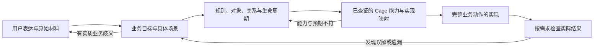

# 让 agent 理解业务并可靠落到 Cage：框架改进提案

本提案记录 2026-11-10 的调查结论。目标是让编程 agent 帮助用户表达业务目标，形成可以核对、可以修正的业务理解，并高效完成 Cage 实现。对象关系、流程、权限、页面和实际业务结果共同检验这项能力。

本文是待实施设计，不是现有 API 说明，也不修改样本应用的业务规则。当前能力以 [开发 Skill](../development/skills/cage-development/SKILL.md)、公开接口和实现为准。此次调查包含用户提供的 [GLM 执行记录](https://zcode.z.ai/cn/share/k6D8Rfjnun8qaHtY-__cq0i0VTvNenvW)、本地生成应用、运行中的业务图谱及框架源码；没有执行新的业务数据库测试或独立 agent 对照评估。

再次展开对话与工具记录后的 [详细复盘](../verification/glm-5.3-agent-review.md)补充了材料提取失真、关键假设验证过晚、规则被实现困难改写、错误解释进入注释、多命令组合与测试重点等问题。迁移覆盖已确认来自 agent 的连续改名操作，随后迁移摘要校验正确报错；不能归因为生成器重写旧草稿。工作记录本身也需要事实核对，避免长期保留错误解释。

**1. 成功应表现为可观察的行为。**

agent 应能把用户的一句话、制度文档、表格、原型或现有系统转化为下面这条持续迭代的工作链。原型只是其中一种证据，输入形式不决定建模方式。

理解程度通过行为判断：能解释对象为什么存在、关系何时成立和结束、哪个事实决定一次操作是否合法；能预测正常和异常场景的结果；能把用户修改的一条规则落实到所有受影响位置；实现遇到困难时保留目标，而不是悄悄减少规则。流程允许边实现边补充认识，已经明确的部分直接推进。

效率也按交付衡量：从开始到核心业务正确运行的时间、API 误用和返工、重复查阅与无效提问。代码量、页面数、提问数或静态检查通过率都不能独立代表成功。

**2. 当前基础已具备，主要缺口发生在几个连接处。**

当前 Skill 已有理解需求、共同澄清、能力查证、编码前映射和业务验收；[业务澄清指南](../development/guides/business-collaboration.md)也已经要求保留用户答案、区分待定事项、避免默默降低要求。[能力选择](../development/guides/recipes.md)已经解释聚合边界和带生命周期的关系。继续添加相似口号的收益有限，需要增强推理示例、工作记录、工具语义和反馈。

| 调查依据 | 已有能力与实际边界 | 改进指向 |
| --- | --- | --- |
| [Skill](../development/skills/cage-development/SKILL.md)、[业务澄清](../development/guides/business-collaboration.md)、[能力选择](../development/guides/recipes.md) | 有步骤和原则；示例主要展示局部规则、阈值或简单归档，复杂业务从模糊输入到修订模型的演示不足 | 补完整推理过程，明确每一步产出怎样支持下一步 |
| [能力检索](../../packages/cli/src/capabilities.ts) | 真实签名来自安装包，检索为连续文本包含匹配；组合示例和限制仍需人工维护 | 按任务提供能力组合、操作语义、前提与限制，并给出匹配依据 |
| [scope](../../packages/kernel/src/scope/index.ts)、[写流水线](../../packages/kernel/src/kernel.ts) | owner 字段表示创建人，创建时优先写入执行主体，更新时保留原值；检索示例却使用 applicantId，未在限制中同步说明代办语义 | 示例必须明确创建人、申请对象、经办人之间的区别 |
| [本体抽取](../../packages/cli/src/ontology.ts)、[上下文查询](../../packages/cli/src/context.ts) | 能追踪已声明对象、引用、行为和源码；关联来自字段声明，不具有独立的用户期望 | 加入规则来源与实现、验收之间的可追踪对应 |
| [派生测试](../../packages/testkit/src/derived.ts)、[状态诊断](../../packages/cli/src/doctor.ts) | 检查声明性质、生成一致性及可用运行证据；没有写出的业务规则无法由这些机制自动补全 | 从编码前的场景保留独立预期，检查遗漏和错误关联 |
| [图谱业务视图](../../packages/cli/src/graph-business.ts) | 无文案时多个节点显示同样的“待命名状态”；process 调用被统一显示为“审批结论” | 修正展示语义，保留可区分标识，让图能支持讨论与排错 |
| [资源配对规则](../../packages/cli/src/rules.ts) | 按 acquires/releases 静态标签推断持有；修复提示只建议释放，不能覆盖真实业务中继续持有等情况 | 诊断区分已发现的声明问题、业务上可能的解释和仍需检查的事实 |

在样本应用安装的 0.3.2 上，实际执行能力检索：“管理员代员工申请”返回 0 项，“本人”返回 7 项，其中 scope 的示例使用 applicantId。无匹配本来就不代表框架不支持；这说明用户语言仍需 agent 先转换成技术词，而命中后的片段也可能弱化重要语义。

记录里 agent 把 safe 视图理解成只负责掩码。但 [DDL 实现](../../packages/kernel/src/db/ddl.ts)为业务表配置了带租户与 sys.in_scope 的读取策略。记录里对 refine 等校验的处理也出现误解；当前和样本安装版本的 [生成器](../../packages/cli/src/gen/index.ts)都将 CAGE-GEN-003 标为 warning，含义是客户端无法完整复制服务端校验。框架需要帮助 agent 保留这些区别。

本次还核对了版本差异：样本应用随附的 Skill、业务澄清和能力选择文档，与当前仓库正文不同；当前仓库已强化编码前映射。两者都有澄清原则，但不能把样本失败直接当作当前教材已经实测失败，也不能把新文字当作效果已经验证。

样本领域声明里已经存在员工和房屋的 ref。退房创建路径检查了员工归属和房屋 occupied 状态，却未在该路径核对“该员工与该房屋当前入住关系”。这只是静态源码发现，不是本次执行的越权测试；它说明外键、可见性、对象状态和业务关联分别需要依据。具体入住人数、床位规则与生命周期仍应由真实需求确定。

**3. 先帮助用户讲清一个可判断的业务场景。**

面对宽泛需求，agent 先形成自己的理解，再围绕影响下一步的歧义提问。最初应了解用户想改善什么、谁在什么情况下做什么、现在怎样处理、完成后谁能看到什么结果。必要时请用户讲一次具体经历，利用例子暴露含糊术语。

例如“做一个设备借用系统，审批后可以领用，也能代申请”，已经提出业务目标，但还没有确定资源何时被占用、实际使用人与操作账号是否相同、归还如何对应原借用。agent 应解释这些选择对实际行为的影响，分批澄清会改变当前设计的内容。用户不必选择 ref、聚合、事务或范围组合子。

材料要保留来源和适用范围。原型可以提供入口、字段、步骤和交互证据，不能据此断言未出现的异常都允许；旧代码证明当前行为，不能自动取代用户目标；用户明确修改旧规则后，应采用新要求并更新受影响记录。推测、建议、用户决定和已观察到的实现行为需要区分。

对已有明确规则直接执行，对普通技术取舍自主决定，对待定业务只暂缓依赖它的部分。功能扩展、排错和样式修改按实际范围使用这个过程，不要求每次任务重新走一次完整建模。

**4. 持续维护少量业务依据，使理解跨过长对话和多次修改。**

复杂任务在项目已有业务文档中维护一份简洁记录；没有合适位置时再新增。简单任务保留在对话即可。第一阶段使用普通 Markdown，复用 [业务澄清指南](../development/guides/business-collaboration.md)的记录约定，不新增运行时 DSL。

| 保留的内容 | 用途 |
| --- | --- |
| 本次目标、范围和关键业务用语 | 避免把功能名清单当作理解，防止同一个词在不同模块含义漂移 |
| 原始材料位置、规则编号、规则正文、来源及决定状态 | 区分用户要求、推断、委托决定、待定与被替代的规则；不能只记“选择 A” |
| 关键场景的起始事实、动作、预期结果与拒绝情形 | 在编码前保存预期，让后续验收不完全依赖已写代码 |
| 对象身份、关系、状态、数据归属与需要共同成立的条件 | 支持设计推演，识别缺少的概念、错误关系和重复事实 |
| 规则对应的实现位置、相关能力证据与验证结果 | 追踪遗漏，用户改规则时定位影响；尚未验证应明确记录 |
| 当前阻塞的业务问题及影响范围 | 防止沉默被当成同意，继续推进独立工作 |

实现和文档避免重复描述全部字段。记录聚焦高价值规则，引用声明和测试；事实变化时同步更新相关段落。用户改答案要标记旧规则被替代，并检查领域、生成物、页面、数据迁移、权限与验收中实际受影响的部分。

工作记录由 agent 随工作维护，用户通过正常对话补充和纠正。它不新增一轮整份文档签字批准，也不能把 agent 写下“已确认”当成用户确认的证据。

**5. 业务模型要能推演行为，再选择存储与框架表达。**

对象和表之间不应直接画等号。先检查对象身份、独立生命周期、同一次动作必须保持的事实，再判断使用已有聚合、引用、集合关系或独立聚合。并非每种关系都需要独立表；具有起止时间、自己的状态或业务属性时，需要进一步分析。

| 必须能解释的问题 | 容易遗漏的区别 |
| --- | --- |
| 这是谁、什么对象，标识依据是什么？ | 操作账号、申请人、实际使用人、所属组织可能不同 |
| 两个对象通过什么事实关联？ | “员工存在且房屋已占用”不能证明该员工住在该房屋 |
| 一个时刻允许多少关联，历史上允许多少？ | 当前唯一与历史一对多不同；条件唯一不能用永久 unique 粗略替代 |
| 哪个事实决定后续动作？ | 申请、批准、分配、实际交付可能是不同事实；不能从页面名称推断它们等价 |
| 名称、金额、归属改变后历史如何显示？ | 当前对象引用、业务快照、派生统计具有不同更新规则 |
| 谁能看、谁能操作、代表谁操作？ | 可见性不证明业务关联正确，能选到对象不证明本次操作允许 |
| 失败、撤销、重复请求或并发时应保持什么？ | 事务、幂等、版本检查和唯一性分别解决不同问题 |

框架已经支持 ref、hasMany、manyToMany 和独立聚合；[关系指南](../development/guides/relations.md)应进一步展示如何从场景选择它们。普通 ref 的存在性、同租户关系、目标可见性、业务归属、生命周期和并发规则要逐项落实，不能因数据库有外键就一起标为完成。

能力映射还要核对实际执行边界。例如 [bindReads](../../packages/kernel/src/pipeline/load.ts)的读取不锁定被读对象；先查无记录再创建不能笼统宣称已保证并发唯一。某些资源规则可以通过同一资源聚合的命令和事务协调，具体方案需验证；不能从“同事务”推导出任意跨对象条件都自动成立。

编码前进行一次简短场景推演：把具体参与人和对象带入规则，说明为什么接受或拒绝，以及动作后留下什么事实。出现无法解释的步骤，就回到规则或模型；不靠增加字段掩盖概念缺失。

**6. 用跨对象例子检验理解，允许多种正确实现。**

以下仅用于教材和隔离评估。假设该评估中的用户已明确：允许管理员代申请；领取后形成借用；归还必须对应一条有效借用；历史借用保留。是否独占设备及具体可见范围仍须另行提供规则。

| 场景 | 编码前应保留的预期 | 需要查证的 Cage 机制 |
| --- | --- | --- |
| 甲为乙办理申请 | 经办人与实际借用人分别可辨，代办不把乙改成甲 | 创建人字段的写入语义；业务主体字段及真实授权路径 |
| 乙领取设备 X | 能指出哪条事实记录乙与 X 的有效借用 | 聚合边界、状态、命令以及关联读取 |
| 为乙归还设备 Y，但 Y 对应另一人的借用 | 不能仅凭 Y 存在且被占用就接受 | 查找有效借用、校验对象身份与业务条件；服务端拒绝路径 |
| 乙归还 X | 对应关系按规则结束，历史仍可查，相关资源结果一致 | 命令、状态与必要的反应、事务、历史查询 |
| 用户后来改为“审批通过即预留” | 更新预留起点以及拒绝、撤回等受影响路径，其他已定规则保留 | 事件与反应、流程和资源规则、页面提示与受影响验收 |

验收看这些结果能否成立，不要求所有 agent 生成相同的表名、表数量或代码组织细节。一个能保留必要身份、历史和一致性的现有对象，可能已经足够；只有生命周期需要时才增加新的聚合。

**7. 能力发现要解释如何正确组合。**

在现有 capabilities、context 和按需阅读之上改进，保留本地运行和真实版本证据。先覆盖评估中反复出错的任务，不把完整手册塞进每次上下文。

| 一次任务检索应提供的内容 | 例子或边界 |
| --- | --- |
| 命中的业务任务和依据 | 代办涉及操作主体、业务主体、范围与审批；匹配只能提出候选，不能确认需求 |
| 当前公开符号与组合位置 | 签名、包版本、指南小节、最小接入示例；保持单一来源，避免示例漂移 |
| 语义和副作用 | 哪些字段由内核赋值、何时提交、以谁的身份执行、结果表示哪个阶段 |
| 前提和适用边界 | 需要哪些导出、迁移、授权或 worker；普通 ref 和集合关系的校验边界 |
| 常见误用与下一步 | scope.self 绑定创建人；safe 查询已有范围约束；warning 不等于服务端规则禁止使用 |
| 验证一个组合所需的最小观察 | 代办后分别读取业务主体与创建人，按明确的角色范围验证实际行为 |

首先修正现有易误解的片段和限制，再评估多词检索、任务词条及结果排序。没有命中、未安装、不支持和应用未启用分别报告。无需承诺任意自然语言都能自动找到正确 API。

若后续评估证明需要，可扩展 context 同时引用当前任务的业务依据和已有声明。新建业务尚无声明时，也应能保留业务依据，而不是让空图变成理解入口的死路。这样的检索扩展属于拟议功能，当前 context 主要查询已有声明。

**8. 实现从核心业务动作开始，反馈来自需求。**

现有 Skill 的“先完成一个动作的保存与读取”适合入门。对完整业务开发，首个动作应覆盖最关键、最不确定的规则，例如正确关联一次领取并拒绝错误归还，同时接通契约、服务端结果与必要页面。只跑通最容易的基础 CRUD，容易把理解错误留到多个模块生成以后。

具体工作顺序是：选择已明确的核心场景，先查最小能力组合，写出规则与实现、验证的对应，再完成声明、生成、接入与必要验证；验证成立后复用结构扩展。遇到新事实时更新工作记录和依赖部分。影响其他模块的规则先处理，未依赖它的工作继续。

验收预期在代码之前形成，后续可以实现为测试与人工观察记录。派生测试继续验证通用性质；业务用例检查正确对象、关系、状态、权限和结果。关键服务端规则需直接请求验证，不能只看页面按钮或表单校验。涉及并发、重复投递等风险时使用有意义的针对性用例，不对每次小改动反复全量测试。

若代码为了通过工具而改变业务含义，应回看规则、实现与诊断的冲突。CAGE-GEN-003 不应促使 agent 删除需要的服务端校验；资源配对提示也不应促使 agent 增加没有业务效果的动作。修复应能够解释它保留了哪条规则。

**9. 工具检查可追踪性，业务正确性依赖场景证据。**

第一阶段用带来源的规则和场景连接实现、验证。只有当维护成本和遗漏问题在试验中明确后，再考虑可选的机器可读关联文件。该文件引用规则编号、声明 key、测试位置和验证结果，不复制整个领域 schema，也不作为内核执行依据。

可自动检查的范围包括：引用的节点是否存在、某条已纳入范围的规则是否尚无实现或验证依据、用户修改规则后哪些旧证据待重验、当前图是否来自目标版本。机器检查通过只能说明这些对应有效，不能证明规则完整、自然语言理解正确或任意 handler 满足规则。

本体图继续作为声明与执行关系的投影。修正错误的动作分类；缺少名称时保留可区分的信息；有来源时展示业务含义与验收依据。明确区分声明关系、静态推断和实际执行记录。已声明规则通过、用户预期覆盖、业务场景执行成功分别呈现，避免一个绿色状态承担过多含义。

**10. 以较小批次实施，并把效果评估纳入交付。**

| 顺序 | 具体交付 | 主要修改位置 | 完成依据 |
| --- | --- | --- | --- |
| P0：建立基线并纠正误导 | 选择现有多轮任务及代办、错误关联等补充场景；固定原始输入与回答；修正 scope 示例、关键语义限制和误导诊断 | [agent-evaluation](../maintainers/agent-evaluation.md)、[capabilities](../../packages/cli/src/capabilities.ts)、[错误码源资料](../../scripts/error-catalog.ts)、[配对诊断](../../packages/cli/src/rules.ts) | 独立基线记录；能力语义和诊断用例通过；没有因提示修复而改变业务目标 |
| P0：把原则变成可复用方法 | 精简 Skill 主流程；增加从模糊输入、澄清、推演到修改规则的完整教材；给复杂任务提供轻量记录示例 | [Skill](../development/skills/cage-development/SKILL.md)、[业务澄清](../development/guides/business-collaboration.md)、[能力选择](../development/guides/recipes.md)、development/examples | 至少两个领域的完整推演可追溯；代码示例可编译；规则改动保留并落实；用户无需回答技术原语问题 |
| P1：减少查阅和遗漏 | 增加重点任务的能力组合与边界检索；按评估需要让 context 引用业务依据；修正图谱分类和重复待命名节点 | [capabilities](../../packages/cli/src/capabilities.ts)、[context](../../packages/cli/src/context.ts)、[graph-business](../../packages/cli/src/graph-business.ts)及相关 UI | 代表性查询能找到正确证据；上下文有界且可追踪；图中的动作分类与声明证据一致 |
| P2：补已证实的通用能力缺口 | 针对跨任务反复出现的范围表达、一致性、查询类型等问题逐项设计 | 对应包的公开接口与实现；需要内核改动时按架构流程评审 | 多领域证明必要性；公开语义明确；真实回归证明行为；不通过增加业务特例解决 |

建议第一批把基线、重点语义修正、一组完整教材和对照评估一起交付，验证方法是否影响实际行为，再扩大工具建设。第一批不需要建设新的通用需求引擎、固定行业模型或通用流程设计器。

教材正文仍只维护在 docs/development；Skill 入口使用既有同步脚本。涉及托管区时先同步范例，再同步模板并构建 CLI。运行 docs:check、相关 docs:examples 和受影响包的检查；语义承诺涉及运行时行为时增加有意义的回归。升级后还要核对应用实际拿到的教材内容，不能只看版本号或仓库正文。

**11. 评估同时回答“理解对了没有”和“实现是否高效”。**

复用 [现有行为评估](../maintainers/agent-evaluation.md)的隔离会话、固定用户回答和独立验收机制。新增覆盖完整业务理解的组合任务：只有口语目标、只有原型、制度冲突、多角色代办、具有时间与状态的关系、开发中途修改规则、材料与安装能力不符。保留清晰的小改动任务，检查新流程是否过重。

每组在相同模型、宿主和工具环境下比较现有流程与改进流程，固定框架及教材版本，重复运行并记录波动。先固定运行时比较教学和检索的变化；再单独评估运行时扩展，避免把多个变量混在一起。原始 0.3.2 样本可用于诊断，不替代当前版本基线。

| 维度 | 记录方法 |
| --- | --- |
| 用户目标与关键规则保留 | 按评估者预先保存的需求核对；遗漏、擅自增添和规则弱化分别记录 |
| 澄清质量与表达帮助 | 问题是否暴露真正的选择、业务影响是否准确；用户能否用业务语言回答；不按问题数量评分 |
| 模型与跨对象行为 | 对象身份、关系时效、操作前提、历史保留和必要的一致性是否在具体场景中成立 |
| 变更保留能力 | 改答案后受影响实现和验收是否更新，有无旧规则残留或重复询问 |
| 框架使用正确性 | 幻造 API、语义误用、绕过命令或范围、复制运行时、未查证便断言缺能力的次数及后果 |
| 交付质量 | 独立业务场景通过、关键拒绝路径、生成一致性、实际页面操作；通过、跳过、未执行分列 |
| 成本与效率 | 首个正确业务动作和完整交付的耗时、工具调用与上下文开销、无效查询、返工和用户介入次数 |

关键业务误解不能被较快耗时抵消。先比较业务成功情况，再比较成功任务的成本，同时保留失败和超时任务。评估者可以用独立脚本或盲审辅助核对；不让被测 agent 的自评或它自行生成的全部测试成为唯一依据，也不固定一种正确数据库设计。

**12. 此次调查的交付边界。**

本提案明确了已有能力、可复核的问题、拟议行为、修改位置和验证方法。调查阶段已查看执行记录、样本源码、运行图谱，复查能力检索结果并比对教材；这些证据足以确定改进方向，但尚不能证明改进后所有 agent 都能稳定理解业务。需要上述对照评估才能判断收益。

截至 2026-11-11，已先落地[本体命名与建模指引](../development/guides/ontology-modeling.md)、能力检索入口、CAGE-ONTOLOGY-001 命名完整性诊断、新脚手架严格配置，以及图谱缺名回退和 process 身份分类修正；相关 CLI、教材与脚手架验证通过。实际结果见[样本复盘](../verification/glm-5.3-agent-review.md)。这些改动闭合名称填写与检查链路，不代表本提案全部实施；业务数据库回归、独立模型对照、规则追踪和拟议的通用能力扩展仍未执行。
