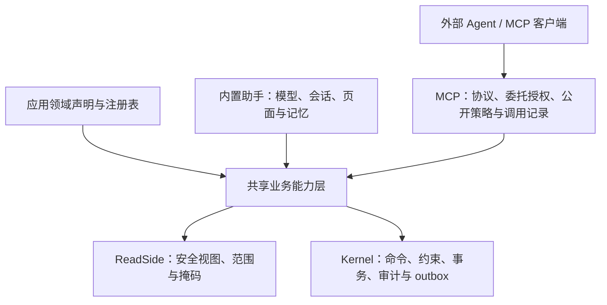
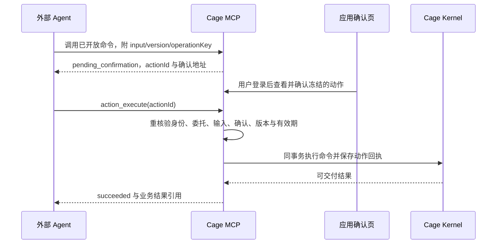

# 外部 Agent 的 MCP 接入规划

状态：设计提案，尚未实现。核对日期：2026-11-07。

本文中的角色审批额度属于旧设计，现已移除；未来接入仍需遵循当前能力、数据范围和业务审批规则。

本文规划让使用 Cage 开发的应用，通过 MCP 向外部 agent 提供业务发现、安全读取与受控操作。文中的新包、声明、工具名、权限点、系统表与状态均为候选设计，不能作为当前可用 API。现有实现以[原生智能化指南](../development/guides/intelligence.md)、公开入口和源码为准。

## 1. 产品目标与首版选择

应用开发者继续声明 aggregate、command、query 和 approval；框架据此构建 MCP 能力目录。应用显式选择哪些能力允许外部访问，管理员允许哪些客户端接入，用户授权该客户端代表自己处理业务。外部 agent 自己推理，Cage 负责解释业务结构、校验身份并执行现有业务规则。

首版以“登录用户授权的外部 agent”为主体，支持远程 Streamable HTTP；应用不需要配置模型，也不需要启用 `ai()`。默认关闭 MCP，开启后仍默认只读；普通写命令逐项开放，默认经应用内确认。新增业务命令不自动进入已有客户端的授权。

验收场景：用户连接采购应用，agent 查询本人可读采购单、理解字段及状态、提出修改、取得用户确认、提交命令并查询结果。两个部门的用户通过同一 MCP 地址得到各自授权内的目录和数据。

无人值守服务账号、代理审批、批量写、附件传输和内部助手代办均为后续范围，不以“外部 agent”名义默认取得系统身份。

## 2. 当前已有的基础与真实缺口

| 能力 | 当前证据 | 规划中的处理 |
| --- | --- | --- |
| 业务语义目录 | [运行本体](../../packages/ontology/src/index.ts)、[分页与授权目录](../../packages/ontology/src/catalog.ts) | 复用字段、状态、命令输入、查询依赖、关联关系及权限过滤；再叠加外部公开策略 |
| 安全读与查询 | [现有工具](../../packages/ai/src/tools.ts)、[有限查询计划](../../packages/ai/src/query.ts)、[ReadSide](../../packages/kernel/src/read.ts) | 复用安全视图、范围、掩码和读取审计；首版优先现有命名查询 |
| 命令调用 | [工具的命令包装](../../packages/ai/src/tools.ts)、[内核](../../packages/kernel/src/kernel.ts) | 复用 Zod、expectedVersion 和 `executePresentedIn`；不直接交付 `executeIn` 的内部快照 |
| 助手持久执行 | [运行循环](../../packages/ai/src/runtime.ts)、[执行上下文](../../packages/ai/src/types.ts) | 写确认、租约及动作回执依赖 AI run；提取业务执行部分，外部请求单独保存记录 |
| 浏览器身份 | [HTTP 认证](../../packages/http/src/auth.ts)、[OIDC](../../packages/http/src/oidc.ts) | 当前 OIDC 是应用登录客户端，不是对外签发 MCP access token 的授权服务器；需要新增委托授权能力 |
| 服务装配 | [RuntimeDefinition](../../packages/kernel/src/runtime.ts)、[HTTP 组合](../../packages/http/src/server.ts) | 复用显式运行扩展和迁移机制；补 HTTP 认证模式与挂载边界 |
| 审批 | [审批引擎](../../packages/approval/src/engine.ts) | 读接口可适配；决定接口会重建用户完整 Ctx，必须专项处理客户端授权上限后才能开放 |

不能直接把 `toolsFor()` 转成 MCP：它依赖 StoredRun、页面、工具装载、确认与 `sys.ai_action`。只调用工具的 execute 会丢失外围确认及持久回执。`ai()` 本身还要求至少一个模型。

## 3. 架构与包职责

建议新增两个包，具体命名在 API 评审时冻结：

| 包 / 模块 | 职责与依赖边界 |
| --- | --- |
| `@yss123/cage-agent-tools`（拟新增） | 与模型无关的目录、schema、预览、安全读和命令执行。依赖 kernel / ontology；不依赖 AI run、Fastify、MCP SDK、模型和浏览器 |
| `@yss123/cage-mcp`（拟新增） | MCP SDK 适配、应用公开策略、外部委托校验、工具结果、调用记录、确认动作和限额；复用 kernel 连接，不另建业务连接池 |
| `@yss123/cage-ai`（调整） | 调用共享业务工具；继续负责模型循环、预算、聊天、记忆、页面交互和现有 AI 回执 |
| `packages/http`（调整） | 按明确的路由认证模式隔离 Cookie 与 Bearer；装配 MCP 和授权服务，保持现有网页登录与 CSRF |
| `packages/admin`（调整） | 管理允许接入的客户端、访问策略与审计；普通用户在应用账户页管理自己的连接和待确认动作，无需系统管理权限 |

共享层的执行输入应缩减为可信 Ctx、kernel、本体、取消信号及可选事务。需要动作事务的命令只能通过宿主的持久动作协调器调用，不能形成另一个公开的无确认写入口。助手与 MCP 各自保留执行生命周期，共享业务语义与校验实现。

首版不新增 `agent` 调用身份或 `invokedBy: 'mcp'`，也不为 MCP 修改业务 handler。OAuth 用户委托仍以该用户为业务主体；可信 client ID 和授权 ID 存在外部调用记录中。真正的无人值守主体另行设计，不能套用用户身份。

## 4. 应用启用与公开策略

候选入口是独立的顶层 `mcp()` 运行声明，与 `ai()` 并列。它描述可公开的聚合读能力、命名查询、明确允许的用户命令，以及确认方式和调用预算。认证服务、issuer、外部地址和密钥由 API 部署配置提供，不放进可序列化的领域声明。

公开策略必须满足：

- 默认拒绝；精确声明开放对象、查询和命令。注册表中存在，不代表对外公开。
- 通用 `data_get/list/related` 每次检查参数指向的对象，关联读取同时检查两侧；不能只检查工具名称。
- 命名查询检查 query 本身及完整 reads 依赖。目录、字段、关联描述也不能透露未公开节点。
- 目录中不包含 handler、原始 SQL、隐藏字段、凭据、AI 提示词、内部对话或偏好记忆。
- 首版不独立提供客户端字段投影或任意行范围表达式，避免形成第二套不完整的权限系统。沿用当前用户的字段安全规则与数据范围，并明确展示这一授权含义。
- 首版敏感明文不随普通 read 自动开放；连接授权须单独包含对应明文能力，且不能超过用户当前权限。
- 命令执行会触发已声明的反应、审批及连接器。这些是该命令的正常业务后果，不要求外部客户端取得每个内部消费者的调用能力；确认说明需提示可识别的后续影响，不能把提交成功描述成异步流程全部完成。

CLI 应在 check / doctor 中区分“包已安装、应用已启用、授权配置完整、迁移已执行、当前进程已挂载、客户端实测通过”。发布前同步 capabilities、AGENTS 托管区、`docs/development` 与两模板；设计阶段不提前把本方案写进现有能力指南。

## 5. 身份、OAuth 与权限缩减

### 5.1 用户连接流程

1. 用户在 MCP 客户端填写应用 MCP 地址。
2. 客户端按受保护资源元数据发现授权服务器。
3. 用户在可信网页登录；Cage 展示客户端、目标应用、对象/操作、当前数据范围、明文访问及有效期。
4. 授权服务器通过授权码与 PKCE 流程签发只面向该应用 MCP resource 的令牌。
5. 每个 MCP 请求校验令牌、issuer、audience/resource、有效期、客户端和授权记录，再解析用户当前权限。
6. 用户可在应用内查看并撤销连接；管理员可停用客户端。后续请求、待确认动作和结果取回均重新核验授权。

OAuth 协议部分采用维护中的标准实现，MCP 服务承担 resource server 职责。为独立应用提供可复用的默认授权服务适配，复用 Cage 登录与同意页面；也允许企业授权服务器适配。阶段 0 必须选定实际库、维护状态及协议能力，不能把当前 OIDC 登录误当作已经具备这些接口。

首版认证目标包含授权发现、预注册客户端、授权码+PKCE、短期 access token、撤销与有界续期。公开客户端不依赖保密的 client secret；刷新令牌按所选标准实现处理轮换及重放。客户端注册机制须按选定规范和首批客户端验收：优先评估 Client ID Metadata Documents，保留受控预注册；不把 Dynamic Client Registration 当作所有接入的前置条件。

仅供开发的短期连接令牌可以用于自动化测试，但不能以“Bearer 可用”宣称任意远程 MCP 客户端已兼容。固定管理员 token、数据库连接串和网页登录 Cookie 不作为交付给 agent 的认证方式。

### 5.2 三层交集与当前范围限制

生效操作集合 = 用户当前业务权限 ∩ 应用 MCP 公开策略 ∩ 本次客户端授权。

OAuth scope 表达外部访问授权，Cage capability / data scope 表达业务规则，二者需要明确映射。建议用粗粒度协议 scope 加服务端保存的对象/命令授权集合；仅有 `write` 字样不能允许所有写命令。

每次请求重新核验三层集合，工具目录仅作发现，实际执行必须再次检查。不要通过增加角色、克隆管理员账号或关闭约束来实现外部访问。令牌的 subject 与租户映射来自服务端授权记录，业务参数不能指定 actor、userId、tenantId 或可信 client ID。

首版客户端只缩减能力集合，数据范围继承用户现有授权；用户部门或角色变化时按当前状态重算。未来如需“用户可看全公司、agent 只看一个部门”，必须实现用户范围与委托范围的 AND 相交语义。当前 `Ctx.scopes` 数组内部是 OR，不能把两组范围拼接冒充交集；该扩展需要内核与安全读两侧一致实现和专项回归。

API 请求途中发生撤权与提交的竞态需定义线性化边界。至少在动作执行事务开始前及取回结果前重新核验；不能承诺撤销已经提交的业务。需要更强撤权语义时，设计授权版本与事务锁，不只依靠通知缓存。

## 6. MCP 工具面与协议选择

### 6.1 首版工具

以下是候选名称，尚未实现。

| 类别 | 工具 / 映射 | 首版范围 |
| --- | --- | --- |
| 发现 | `ontology_search`、`ontology_describe` | 当前公开且获授权的业务摘要、字段、状态、参数及关系 |
| 读取 | `data_get`、`data_list`、`data_related` | 有界分页、安全视图、掩码、关联双侧校验 |
| 查询 | 从白名单 query 生成的独立工具 | 保留精确 inputSchema 和 reads；不接收 SQL |
| 命令 | 从白名单 user command 生成的独立工具 | 精确输入、已有对象必填 expectedVersion、稳定 operationKey；默认产生待确认动作 |
| 动作 | `action_get`、`action_execute` | 读取本人该连接的状态；执行已确认的不可变动作，不能覆盖输入 |
| 审批读取 | `approval_tasks`、`approval_history` | 限本人待办及可读对象；先补有界分页和公开策略过滤 |

`tools/list` 按当前授权过滤、确定性排序并分页，工具名稳定映射到业务声明。名称规范化后必须检测冲突；JSON Schema 与服务端真实 Zod 校验来自同一份声明，不能因 schema 无法完整表达 refine/transform 就放松服务端校验。

有限统计 `data_query` 可在第二轮加入，共用现有计划执行器，并核验聚合、字段、指标和输出预算。首版用命名查询降低复杂度。需要 resources 的客户端可后续加入权限过滤的本体片段和业务对象 URI；核心任务必须能仅通过 tools 完成。Prompts 属于可选任务配方，不承担授权，也不公开内部系统提示。

现有助手的 `tool_search/tool_load` 会修改后续模型请求的装载集合，不能直接复制成 MCP 的连接状态。首版采用应用白名单控制工具规模；大应用的按需发现另行设计，不在共享连接上隐式更改工具列表。

### 6.2 传输与版本

推荐远程 Streamable HTTP，候选地址 `/mcp`。正式部署使用 HTTPS 和可信代理配置。stdio 可后续提供本地桥接器，桥接到同一远程服务，不把数据库或内核权限发到 agent 本地。

2026-11-07 查阅的官方 `2026-07-28` 规范已与 `2025-11-25` 有重要差异：新版本移除 initialize 握手、协议会话和 GET 流，增加 `server/discover` 与每请求元数据；工具和资源列表要求缓存语义；长期任务移入扩展。因此不能直接沿用旧教程把 MCP session ID 当作授权或业务会话。

首发版本由两个实际目标客户端与官方 TypeScript SDK 的共同支持能力决定。阶段 0 用 Inspector 与客户端实测并冻结矩阵；只有目标客户端确实需要时才同时适配 `2026-07-28` 与 `2025-11-25`。不能在协议响应中虚报支持，也不为尚未确定的客户端预先实现完整兼容平台。

按协议版本分别处理发现/初始化、元数据、响应格式与错误；新协议支持目标包括 `resultType`、所需 HTTP 头及其与请求体的一致性。按用户和授权隔离目录缓存，新协议使用 `cacheScope: private` 和明确 `ttlMs`，首版可为 0；旧协议连接不能复用其他用户的工具集合或结果。新协议无会话不代表业务无状态，actionId 等由服务端显式创建并逐次校验归属。

对 MCP 子路由使用 Bearer 认证；网页同意页和确认页继续使用 Cookie+CSRF。当前全局 CSRF hook 不支持直接插入这一分界，需要明确路由认证模式和封装边界。不能全局设置 `csrf: false`，也不能让 MCP 请求在缺少 Bearer 时回退成浏览器 Cookie 身份。处理 Origin、Host/可信外部地址、请求大小、速率和超时，并测试新路径不被 SPA fallback 接管。

## 7. 写入确认、幂等与恢复

### 7.1 一次用户确认的完整生命周期

待确认动作绑定：应用/租户、用户、可信客户端、授权记录、工具标识、规范化输入摘要、目标对象及 expectedVersion、公开策略/注册指纹、确认方式和有效期。确认后不允许替换输入；发生影响执行的声明、授权或版本变化时要求重新准备动作。

首版在应用自己的可信页面完成确认。agent 传入 `confirmed: true`、普通工具 `confirm(actionId)` 或客户端声称“用户同意”都不能代替确认凭证。MCP elicitation 可用于引导打开确认页；其回复本身不证明符合 Cage 所需的人类确认或二次认证。需要 step-up 的业务命令必须取得真实认证证据，无法满足时明确拒绝。

低风险命令以后可由管理员明确设为允许自动执行，并经用户同意；这属于事先委托授权，仍保留逐次鉴权、约束、限额、幂等和审计。自动执行策略不能由模型在调用参数中选择。

### 7.2 持久动作与事务

建议增加 `sys.mcp_grant`、`sys.mcp_action`、`sys.mcp_call` 等独立记录，名称和字段待实现评审确定；OAuth 凭据表由选定的授权服务器实现管理，避免重复自制认证存储。

- action 保存冻结输入、必要的确认及身份依据、状态和回执；不依赖 AI run，也不占用模型 worker。
- 用户业务输入可能含敏感信息：只保存执行必需数据，管理页/日志不直接展示原文；定义访问权限、加密需求、保留时间与清理方式。
- 同租户、用户、客户端、授权记录、工具及 operationKey 建立唯一约束，输入摘要另行核对。同键同输入返回原动作，同键不同输入明确冲突。
- 执行时锁动作行，在一个数据库事务中复核状态、调用 `executePresentedIn`、写成功回执。传给内核的 Ctx 显式清空 `idempotencyKey`，由外层动作独占去重责任；不能把 operationKey 原样传给另一套按主体/命令命名的内核幂等记录，避免不同连接或网页请求碰撞。事务失败整体回滚；确认等待期间不持有业务事务或行锁。
- 内核现有幂等记录不保存输入摘要，不足以单独承担外部调用合同。MCP 使用自己的动作去重和同事务回执，不把 MCP request ID、模型 tool call ID 或网络连接 ID 当业务幂等键。
- 返回已提交结果前重新核验当前对象可见性、字段规则和明文权限。授权指纹只可用于快速拒绝：即使用户授权未变，对象也可能已移动部门或改变归属，旧回执不能直接回放。首版优先返回获授权的执行状态及对象引用，再由安全读侧重新读取业务内容；无法可靠重核验的历史快照不交付。已删除对象的执行状态与历史内容读取同样分开处理。
- 取消与连接断开表示停止等待或请求中止，不证明业务回滚。提交成功但回包丢失时，通过同一 actionId 查询/重取结果；不能自动换 operationKey 再写一次。
- 明确幂等及回执保留窗口，例如首版最低 24 小时；过期 actionId 不得触发重新创建与执行。删除去重记录后不能继续承诺无限期去重，客户端应把新 key 视为新业务意图。

候选状态为 `pending_confirmation / approved / succeeded / failed / rejected / expired`。并发执行通过数据库事务锁串行决定，只有事务提交后的 succeeded 才表示命令成功。失败与重试区分输入错误、版本冲突、权限失效和临时系统错误；版本冲突不自动修改 expectedVersion 重试。

命令成功仅指其事务和同事务反应成功；后续 outbox、审批或 ERP 状态通过安全查询读取。工具超时不能伪装成业务失败。导入导出等长任务后续复用原有任务记录并返回 taskId，不先另建通用工作流引擎，也不要求所有客户端支持 MCP Tasks 扩展。

## 8. 结果、审计与用量

MCP structuredContent 返回稳定业务结构，同时提供兼容的文本摘要。业务结果至少能表达 requestId / actionId、执行状态、领域错误码、对象及版本、分页或截断边界。候选待确认状态作为正常业务结果返回；schema 错误、权限拒绝、约束失败和版本冲突提供可修正的工具错误，协议结构错误与未知工具遵循所选版本 JSON-RPC 错误规则。

认证失败在传输层使用相应 OAuth challenge，不能用 HTTP 200 的普通业务错误掩盖；未知或无权对象保持现有不泄露存在性的语义。不要把数据库异常、栈、凭据、内部原始查询或隐藏字段交给客户端。

返回条数有界不等于数据库执行有界。现有命名查询包装主要在返回后截断；对外开放前补数据库 statement timeout、结果字节上限和并发预算，验证昂贵查询可终止。超限明确说明，不能默默把不完整数据称为全集。

业务审计继续由内核写入；外部调用记录增加可信 client ID、grant ID、用户、租户、工具、动作、请求、耗时、结果码以及确认依据，并通过 requestId/actionId 关联。`clientInfo.name` 和 User-Agent 属于客户端自报信息，不可作为可信审计主体。成功写的外部动作回执与命令审计同事务提交；失败尝试另记，不泄露输入明文。

限额至少覆盖租户、客户端和用户的请求量、并发、待确认动作数、查询行数/字节及超时。首先清楚声明单实例支持范围；多实例限额需共享协调，不能把每进程 rate limit 宣称成全局预算。

## 9. 审批与机器身份的后续边界

现有 `approval_decide` 调用 `InCodeEngine.decideIn(taskId, userId, tenantId, ...)`，引擎内部重新取得用户完整权限。MCP 中已裁剪的 Ctx 不会自然传入结论命令。

因此首版只开放审批待办和历史读取。审批操作后续须让可信委托上限贯穿待办身份、单据读取、结论命令及相关审计，保持本人待办、职责分离、额度与版本规则；外部 agent 不能调用 `review_decide` 冒充框架的 AI 审核节点。

无人值守 agent 后续采用独立服务主体、独立授权及生命周期。要明确其部门归属、范围、额度、调用身份、能否触发需要真人的约束，以及负责人与审计；不能给它一个后台管理员 Cookie，也不能把 client ID 当 userId。应用的真实多租户生命周期尚未完成，本方案保持每次调用绑定服务端租户，不借 MCP 宣称补齐 SaaS 多租户。

## 10. 分阶段实施与验收门槛

| 阶段 | 交付内容 | 进入下一阶段的证据 |
| --- | --- | --- |
| 0：协议与身份验证 | 官方 SDK / OAuth 实现选型；冻结两个真实客户端及协议版本矩阵；确定授权服务默认部署；设计公开策略和动作数据模型 | Inspector 与客户端完成发现、登录授权、只读工具调用、撤销；记录真实版本与限制 |
| 1：只读可用 | 提取共享业务工具；独立 mcp 声明与包；OAuth 委托、目录、安全读、命名查询、本人审批读取、连接管理和调用审计 | 无 `ai()`、无模型配置的应用可连接；用户/部门隔离、撤权、白名单和查询预算通过真实 PostgreSQL 与客户端测试 |
| 2：受控写入 | 明确白名单用户命令；可信确认页、持久动作、同事务回执、幂等/恢复、版本冲突；完整框架分发与指南 | 两个客户端完成创建/修改/提交与断线重取；并发同 key 只有一次业务变化；无权或过期确认不能提交 |
| 3：业务扩展 | 审批决定、无人值守服务主体、范围进一步缩减、附件/导入导出、resources、可选任务扩展 | 每项按业务与身份单独验收；不由“协议已连通”推断全部能力可用 |

阶段 1 可作为只读预览版本；阶段 2 才构成“外部 agent 可受控办理业务”的完整首版。实现按阶段拆分 PR，避免把协议、OAuth、工具重构和审批授权变化一次混合发布。

建议首版排除：任意 SQL、全库导出、默认所有命令开放、任意跨工具事务、修改系统角色/模型凭据、直接调用内部 process/job/external 命令、通用远程代码执行，以及复制内部助手聊天记忆。需要这些业务时，通过专门受控能力评审。

## 11. 必须覆盖的回归与交付

1. **身份与公开策略**：未登录、错误 audience/issuer、过期/撤销、停用用户/客户端、客户端 A/B 隔离、主体与租户伪造、同用户不同授权；目录和实际调用一致拒绝。
2. **数据边界**：不同部门、范围外对象、敏感掩码、关联双侧、命名查询全部 reads、未公开字段/节点、缓存混用与撤权后回执；覆盖用户权限未变但对象移出范围时的旧回执，通用工具不能绕过公开策略。
3. **写入正确性**：只能调用开放的 user 命令；参数篡改、过期确认、客户端自报确认、真实 step-up、旧版本、同键异参、并发重复、事务失败、进程重启和提交后断线。
4. **业务语义**：命令仍通过约束、审计、outbox 及同事务反应；提交成功与 ERP/审批完成分开，客户端不因超时盲目重发。
5. **协议和资源约束**：目标版本、工具 schema、分页、工具错误、private 缓存、Origin、协议头、Cookie/CSRF 分界、SPA 路由、速率/字节/超时，两个客户端真实操作。
6. **现有助手回归**：共享层抽取后原有助手与 AI 审批保持已实现语义；核对确认、动作回执、上下文预算和模式隔离。
7. **独立应用交付**：空白应用不启用 AI 也能显式启用 MCP；采购范例完成 read/confirm/write；CLI 打包、公开导出、系统迁移、模板同步、capabilities、doctor、指南和仓库外安装验证。

如需修改内核授权语义，应先说明必要性、保存适用基线并提供有意义的数据库回归，发布前交架构负责人评审。系统表用新迁移；不改已发布迁移。所有新增/修改手写源码遵守[中文注释规范](../development/reference/commenting.md)。

## 12. 规范依据与本次验证状态

查阅的官方资料：

- [MCP 2026-07-28 变更](https://modelcontextprotocol.io/specification/2026-07-28/changelog)
- [Streamable HTTP](https://modelcontextprotocol.io/specification/2026-07-28/basic/transports/streamable-http)
- [版本与兼容](https://modelcontextprotocol.io/specification/2026-07-28/basic/versioning)
- [授权规范](https://modelcontextprotocol.io/specification/2026-07-28/basic/authorization)
- [客户端注册](https://modelcontextprotocol.io/specification/2026-07-28/basic/authorization/client-registration)
- [工具与结构化结果](https://modelcontextprotocol.io/specification/2026-07-28/server/tools)

本次仅规划与源码/规范核对，没有 MCP 实现、迁移、OAuth 部署、客户端联调或数据库验收。现有框架能力、候选设计与未来验收必须分别陈述。最终交付的文档检查结果另见本次工作回复，不能把设计内容视作已经通过的测试。
